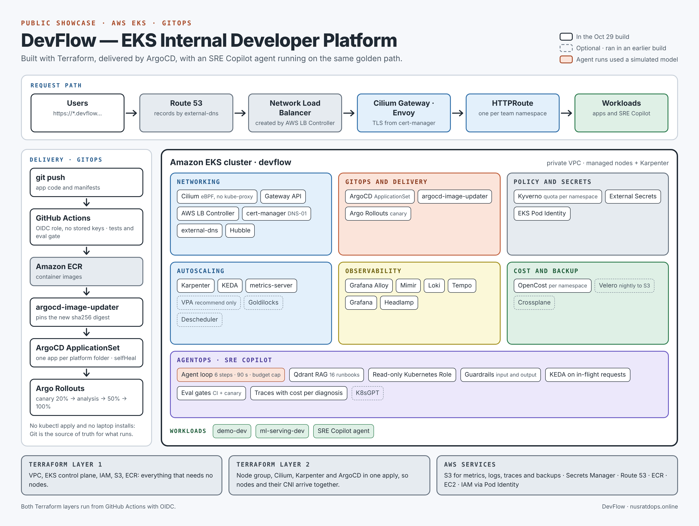
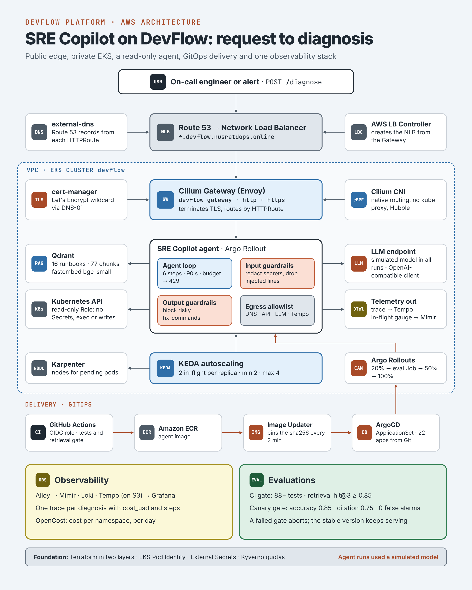

# DevFlow — EKS Internal Developer Platform (public showcase)

A solo-built, GitOps-driven Kubernetes platform on AWS EKS, with an AI SRE agent
("SRE Copilot") running on top of it. This repo holds **curated excerpts** from my
private platform repository: real configuration and real screenshots from the live
cluster, so you can see how it is built without me publishing everything.

> Screenshots were captured on **2026-10-29** from the running cluster. The cluster is
> torn down between work sessions to control cost, so there is no permanent live URL.

## Architecture

The whole platform on one page: the request path, the GitOps delivery path, what runs
inside the EKS cluster, and the two Terraform layers underneath. Solid boxes ran in the
2026-10-29 build; dashed boxes are optional tools that ran in an earlier build.

## SRE Copilot on the platform

SRE Copilot is an AI agent that diagnoses broken Kubernetes workloads. It runs on the same
golden path as every other app: Route 53 → Network Load Balancer → Cilium Gateway →
the agent, which retrieves runbooks from Qdrant, reads cluster state through a read-only
Kubernetes role, and returns a cited diagnosis. It is wrapped in input and output
guardrails, scaled by KEDA on in-flight requests, released as an Argo Rollouts canary
gated by evals, and traced end to end with cost per diagnosis.

> Agent runs used a simulated model, not a real LLM. Details in [`sre-copilot/`](sre-copilot/).

## What is in here

| Folder | What it shows | Real evidence |
|---|---|---|
| [`cilium/`](cilium/) | Cilium as the CNI on EKS: ENI IPAM, native routing, kube-proxy replacement, Hubble, Gateway API | Helm values + datapath diagrams |
| [`sre-copilot/`](sre-copilot/) | Observability for an AI agent: Alloy → Mimir / Loki / Tempo, cost-per-diagnosis and live-cluster dashboards, canary releases gated by evals | Grafana + Argo Rollouts screenshots, Alloy config, dashboard JSON |
| [`headlamp-gitops/`](headlamp-gitops/) | The GitOps pattern: one ApplicationSet discovers tools by folder, with Headlamp as a worked example | ArgoCD + Headlamp screenshots, manifests |

## Platform at a glance

- **Infra:** Terraform in two layers (AWS resources, then cluster bootstrap), EKS Pod Identity (no IRSA keys), GitHub Actions with OIDC (no long-lived AWS keys)
- **Networking:** Cilium (eBPF), Gateway API, cert-manager, external-dns, AWS Load Balancer Controller
- **GitOps:** ArgoCD + ApplicationSets, argocd-image-updater, Argo Rollouts
- **Policy / secrets:** Kyverno (namespace quota enforcement), External Secrets Operator
- **Scaling:** Karpenter (nodes), KEDA (event-driven pods)
- **Observability:** Grafana Alloy as the single collector → Mimir (metrics), Loki (logs), Tempo (traces), Grafana
- **AI ops:** SRE Copilot, an agent that diagnoses broken workloads using runbook retrieval and read-only cluster tools

## Honest notes

- **The model in the screenshots is simulated.** The cost dashboard shows `sim-model`:
  the agent, tools, retrieval, metrics and autoscaling were real, but the LLM was a
  stand-in, so "Real LLM $" is $0 and "Shadow LLM $" is what the same tokens would
  cost on a priced API. See [`sre-copilot/`](sre-copilot/).
- **Excerpts only.** Terraform, policies, networking and most manifests live in a
  private repo. Account IDs, role ARNs and the repo URL are removed or replaced with
  placeholders, and two screenshots are redacted.
- Some screenshots show real failures (an OOMKilled pod, failing probes during a canary,
  a load-balancer creation rejected by AWS). I kept them in: that is what operating a
  platform looks like.

## Author

Nusrat — platform engineer. GitHub: [@opswithnusrat](https://github.com/opswithnusrat)
