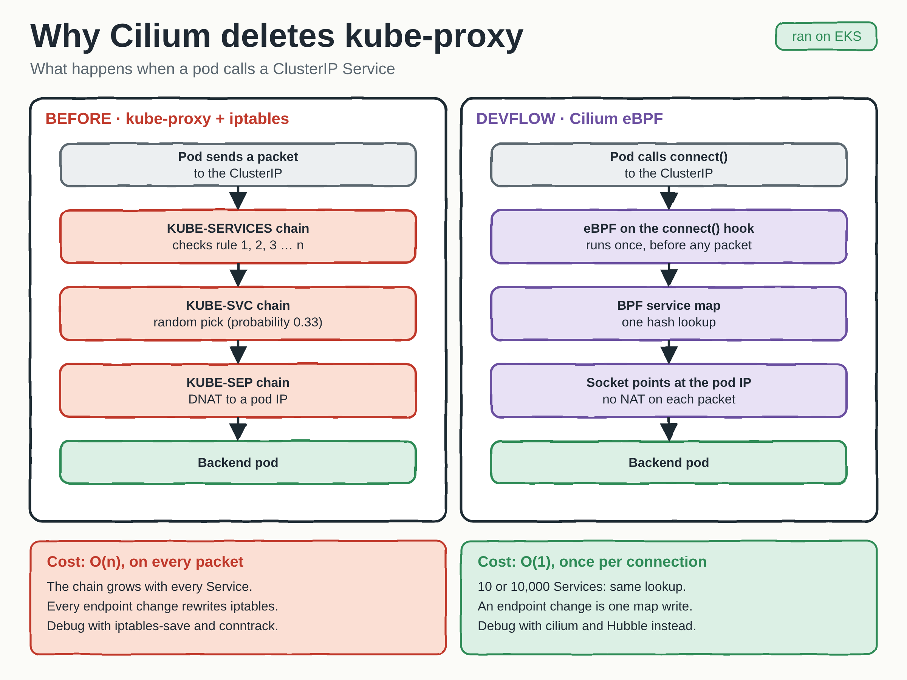
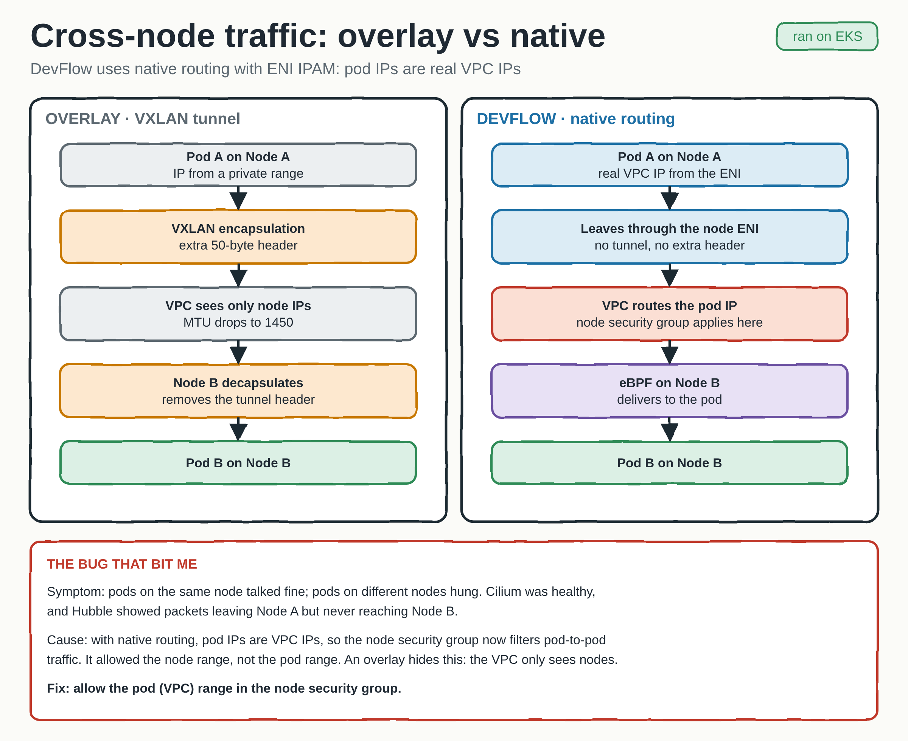
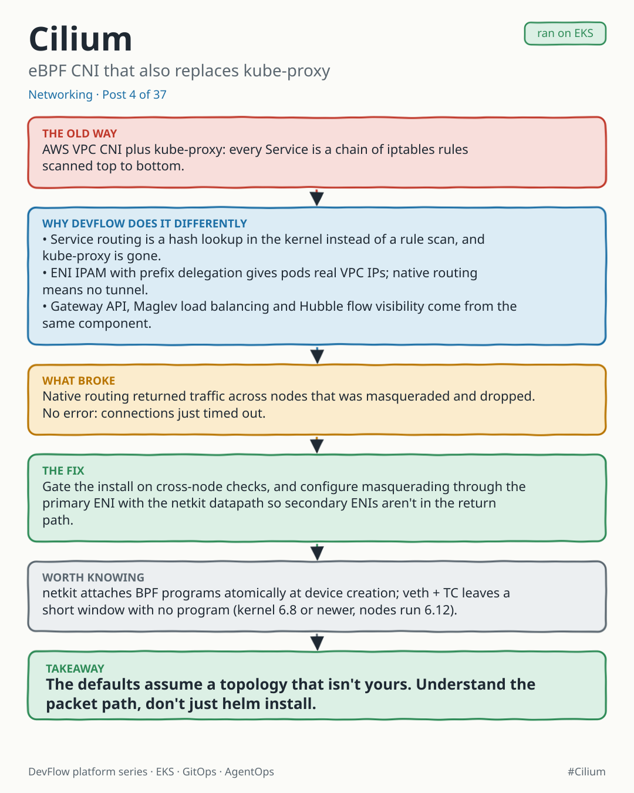

# Cilium on EKS

[`values.yaml`](values.yaml) is the Helm values file I run Cilium with on EKS.
Cilium replaces both the AWS VPC CNI (`aws-node`) and `kube-proxy`.

## Choices worth explaining

| Setting | Why |
|---|---|
| `kubeProxyReplacement: "true"` | eBPF service load balancing instead of iptables chains |
| `ipam.mode: eni` + `awsEnablePrefixDelegation` | Pod IPs are real VPC IPs, allocated a /28 at a time instead of one IP per API call |
| `routingMode: native` | No VXLAN tunnel, no extra header, no MTU loss |
| `bpf.datapathMode: netkit` | BPF attaches at the device, so a new pod never has a window with no BPF program (needs kernel 6.8+) |
| `loadBalancer.mode: snat` | `hybrid` uses DSR for TCP, which AWS drops; SNAT works everywhere |
| `operator.extraArgs: --aws-enable-prefix-delegation=true` | The operator reads this from CLI args, not the ConfigMap. Without it, ENIs only get secondary IPs and the operator attaches and releases ENIs in a loop |
| `gatewayAPI.enabled` | Gateway API implemented by Cilium, no separate ingress controller |
| `hubble` + relay + metrics | Flow visibility for debugging drops, DNS and TCP |

Options I tried but disabled until I could verify them are left commented out in the
file, with the reason (for example BIG TCP and local redirect policies).

## Why Cilium removes kube-proxy

## Native routing, and the bug it exposed

With ENI IPAM and native routing, pod IPs are VPC IPs. That changes which firewall sees
the traffic, and it bit me: pods on the same node talked fine while cross-node pods hung.
Cilium was healthy and Hubble showed packets leaving node A but never arriving at node B.
The node security group allowed the node range but not the pod range. An overlay hides
this because the VPC only ever sees node IPs.

## Post

