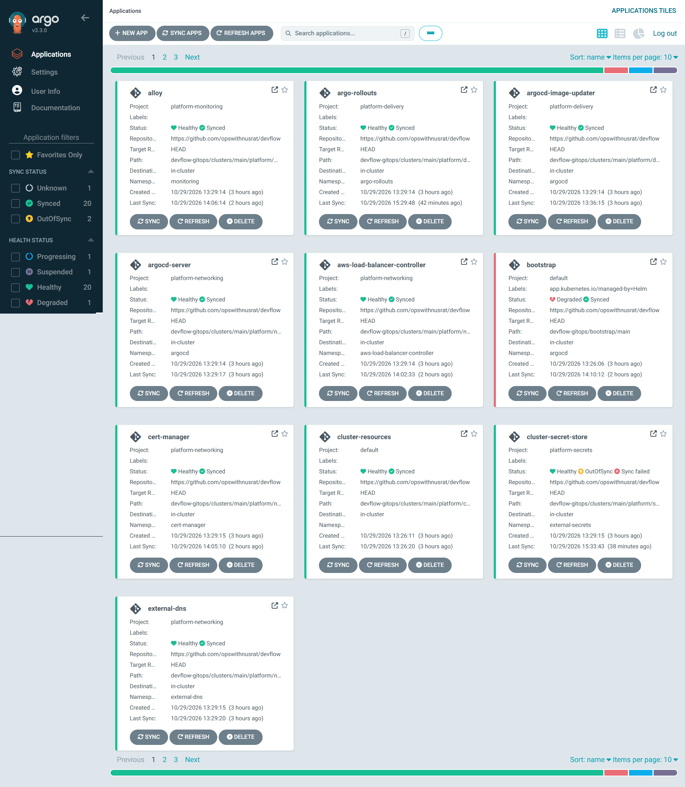
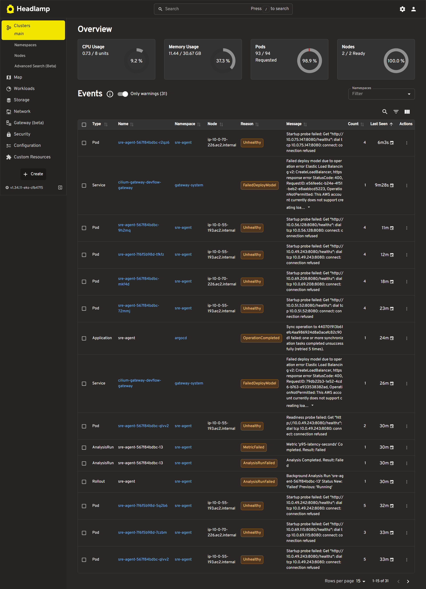
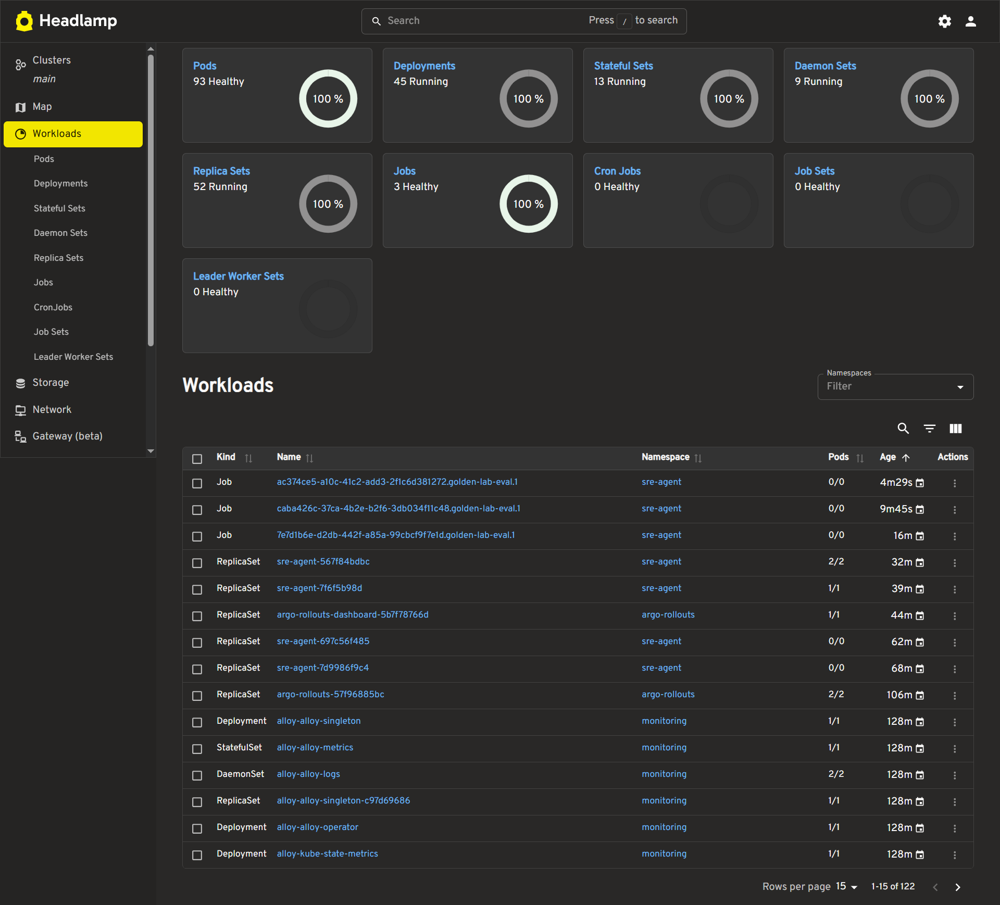
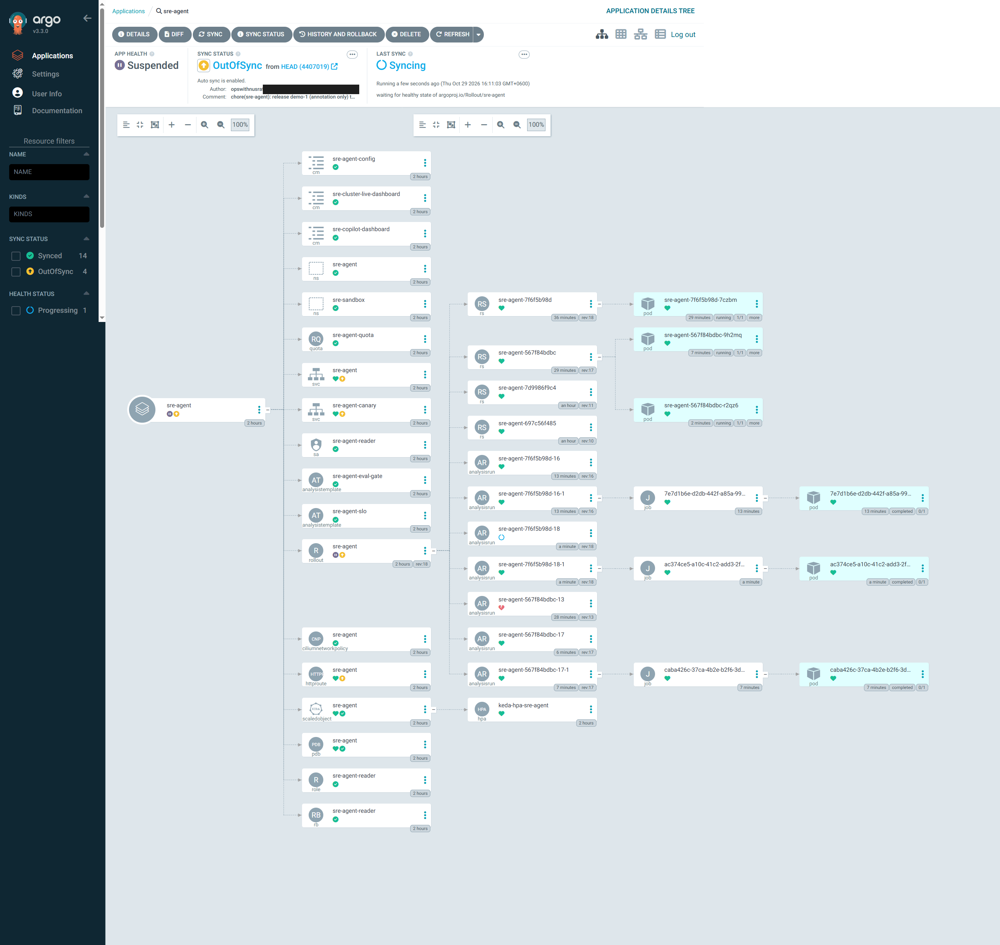
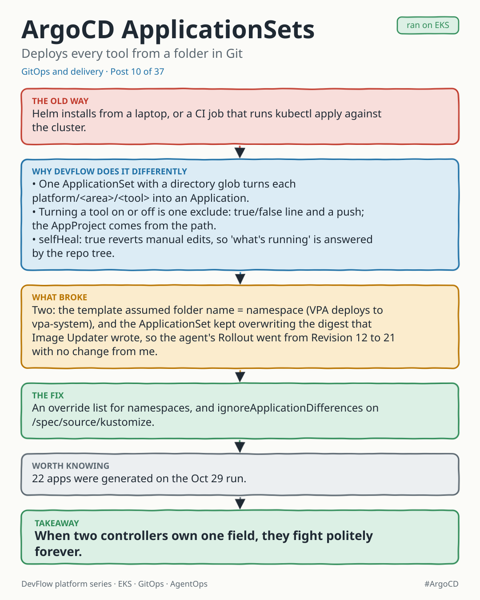
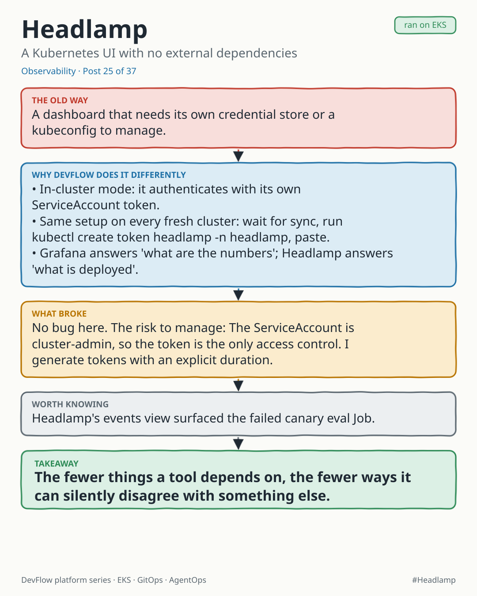

# GitOps with ArgoCD, and Headlamp as a worked example

Every platform tool is a folder in Git. One ApplicationSet finds the folders and creates
one ArgoCD Application per tool, so adding a tool means adding a folder and turning on a toggle.

## How discovery works

[`argocd/platform-applicationset.yaml`](argocd/platform-applicationset.yaml) uses a git
directory generator over `platform/<area>/<tool>`. Each tool then has one entry marked
`exclude: true` (off) or `exclude: false` (on). Flipping a toggle and pushing installs
or removes the tool; prune cleans up.

Each area (monitoring, networking, delivery, policy, ...) has its own
[AppProject](argocd/platform-monitoring.yaml) that limits which repos, Helm
registries and namespaces that area may deploy to.

## Example: Headlamp

[`headlamp/`](headlamp) is a complete tool in about 100 lines:

- `kustomization.yaml`: renders the Headlamp Helm chart (version pinned) with inline values
- `namespace.yaml`: sync wave `-10` so the namespace exists first; annotated to be exempt from the Kyverno namespace-quota policy
- `httproute.yaml`: exposes it through the shared Gateway API gateway; external-dns creates the DNS record from the annotation

Design notes:

- `inCluster: true`: Headlamp uses its pod's service account, so there is no kubeconfig secret to manage and a fresh deploy works with no manual step.
- Sync waves order the rollout: namespace (-10), chart (5), route (10).
- **Trade-off:** Headlamp is bound to `cluster-admin` here because this is a single-operator platform. For a team it should be a read-only role, with access through OIDC.

Headlamp's Events view surfaced real problems during the run: failing startup probes on
canary pods, an Argo sync failure, and a load-balancer creation that AWS rejected on
the new account.

## One app, as ArgoCD sees it

The SRE Copilot agent app: Rollout, Services, KEDA ScaledObject, PDB, network policy,
HTTPRoute, AnalysisTemplates, and the Jobs the canary analysis launched.
(Commit author email is redacted.)

## Posts

